<div align="center">

# Vibe Guardian 🛡️

**Pre-commit security gate for vibe coding.**
Catches the vulnerabilities AI coding tools ship the most — *before* they reach a commit.

[](https://github.com/wbw20000/vibe-guardian/actions/workflows/ci.yml)
[](https://www.npmjs.com/package/vibe-guardian)
[](https://www.npmjs.com/package/vibe-guardian)
[](LICENSE)



</div>

Cursor, Claude Code, and Lovable write code fast — and hardcoded API keys, SQL injection, and wide-open Supabase tables arrive just as fast. Vibe Guardian stops them at two gates:

1. **While AI writes** (Claude Code plugin): every file Claude writes is scanned instantly; on findings, Claude is told exactly what's wrong and fixes it on the spot.
2. **At commit time** (git pre-commit hook): vulnerable code never makes it into your history.

**100% local static rules. No LLM calls. Zero dependencies. Millisecond scans. Your code never leaves your machine.**

## Quick start

```bash
npx vibe-guardian scan            # scan your project right now
npx vibe-guardian install-hook    # install the git pre-commit gate
```

As a Claude Code plugin:

```
/plugin marketplace add wbw20000/vibe-guardian
/plugin install vibe-guardian@vibe-guardian
```

## What it catches

| Category | Rules | Severity |
|----------|-------|----------|
| Secrets | AWS / OpenAI / Anthropic / GitHub / Stripe / Google / Slack keys, private key blocks, plaintext password assignments, committed `.env` files | error |
| Secrets | JWT literals | warn |
| SQL injection | Template-string / string-concat / Python f-string built queries | error |
| XSS | `innerHTML`, `dangerouslySetInnerHTML` (unsanitized), `document.write`, `insertAdjacentHTML` | warn |
| Command injection | `eval` / `new Function` / `exec` with interpolated input | error |
| Supabase | `service_role` key in client code, `NEXT_PUBLIC_`-prefixed secrets, `CREATE TABLE` without Row Level Security | error / warn |
| Config | CORS wildcard + credentials | warn |

Only high-confidence rules (**error**) block your commit — heuristic rules (**warn**) just tell you. No alert fatigue, no `--no-verify` temptation.

False positive? Add `// vibe-guardian: ignore` on (or above) the line.

## Commands

```
vibe-guardian scan [paths...]     scan files/directories (default: cwd)
vibe-guardian scan --staged       scan the git staging area only
vibe-guardian install-hook        install the pre-commit hook
vibe-guardian uninstall-hook      remove the pre-commit hook
  --strict                        treat warnings as failures
  --json                          JSON output
```

## Show you're protected

Tell your users their keys are safe — add the badge to your README:

```markdown
[](https://github.com/wbw20000/vibe-guardian)
```

[](https://github.com/wbw20000/vibe-guardian)

## FAQ

**How do I stop AI-generated code from leaking my API keys?**
Install the pre-commit gate (`npx vibe-guardian install-hook`). Hardcoded OpenAI/AWS/Stripe/Supabase keys are blocked before they ever enter git history — where scrapers find them within minutes of a push.

**Does my code get sent anywhere?**
No. Vibe Guardian is pure local static analysis — no LLM calls, no telemetry, no network requests at all.

**How is this different from gitleaks or semgrep?**
Those are excellent general-purpose scanners aimed at security teams. Vibe Guardian is built for vibe coders: zero config, zero dependencies, rules focused on what AI assistants actually get wrong (including Supabase RLS misconfigurations), and a Claude Code hook that catches issues *while the AI is writing* — not just at commit time. It's a first gate, not a replacement for full SAST in enterprise CI.

**Which AI coding tools does it work with?**
The pre-commit hook protects any repo regardless of editor — Cursor, Windsurf, VS Code Copilot, Lovable exports. The write-time hook is Claude Code native.

---

<div align="center">

## 中文说明

</div>

> Vibe coding 的预提交安全门禁 — 在代码提交前拦截 AI 生成代码中的常见漏洞。
> **100% 本地静态规则，不调用任何 LLM，零依赖，毫秒级扫描，代码绝不离开你的电脑。**

给用 Cursor / Claude Code / Lovable 做 vibe coding 的独立开发者：AI 写代码很快，但硬编码密钥、SQL 注入、裸奔的 Supabase 表也来得很快。Vibe Guardian 在两道关口拦住它们：

1. **写入时**（Claude Code 插件）：AI 每次写文件后立即扫描，发现问题直接让 AI 当场修复
2. **提交时**（git pre-commit 钩子）：带漏洞的代码根本进不了 commit

### 快速开始

```bash
npx vibe-guardian scan            # 扫描当前项目
npx vibe-guardian install-hook    # 安装 git pre-commit 钩子
```

作为 Claude Code 插件：`/plugin marketplace add wbw20000/vibe-guardian` → `/plugin install vibe-guardian@vibe-guardian`

### 检测规则

| 类别 | 规则 | 级别 |
|------|------|------|
| 密钥 | AWS / OpenAI / Anthropic / GitHub / Stripe / Google / Slack key、私钥块、通用明文密码赋值、误提交 .env | error |
| 密钥 | JWT 字面量 | warn |
| SQL 注入 | 模板字符串/字符串拼接/Python f-string 拼 SQL | error |
| XSS | innerHTML、dangerouslySetInnerHTML（无消毒）、document.write、insertAdjacentHTML | warn |
| 命令注入 | eval / new Function / exec 拼接变量 | error |
| Supabase | service_role key 出现在客户端代码、NEXT_PUBLIC_ 前缀密钥、建表未启用 RLS | error / warn |
| 配置 | CORS 通配 + credentials | warn |

**只有高置信度规则（error）才拦截提交**，启发式规则（warn）只提示——不制造狼来了，不逼你 `--no-verify`。

误报处理：在该行或上一行加注释 `// vibe-guardian: ignore`。

### 设计原则

- **零依赖、纯本地**：不上传任何代码，不调用任何 API，隐私和速度都有保证
- **error 才拦截**：高置信度规则（密钥、SQL 注入）阻断提交；启发式规则只警告
- **给 AI 看的报错**：Claude Code 钩子的 block 消息直接告诉 AI 怎么修，形成"写→拦→自动修"闭环

## License

MIT
